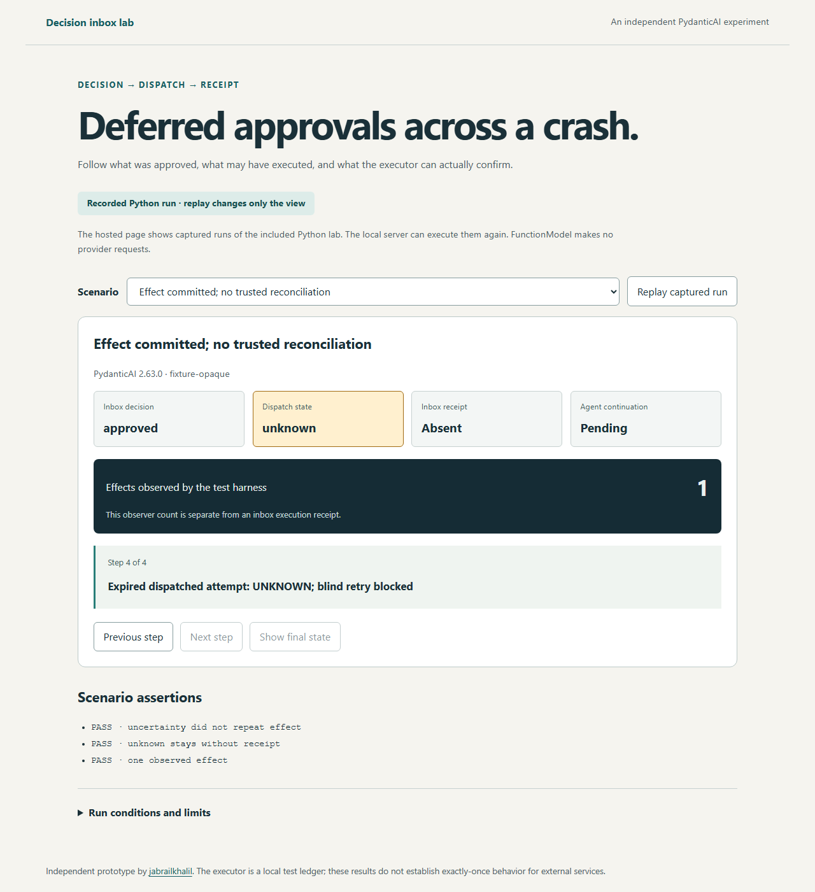

# PydanticAI decision inbox lab

I built an independent experiment around PydanticAI's existing
`DeferredToolRequests` and `DeferredToolResults` APIs. I keep a saved decision,
dispatch, an executor receipt, and agent completion as separate facts.

[Open the recorded-run viewer](https://jabrailkhalil.github.io/pydantic-ai-decision-inbox/).
The hosted page replays captured executions of the Python lab. To execute the SDK,
SQLite transactions and crash scenarios now, use the CLI or local server below.



I started this after [#11847](https://github.com/pydantic/pydantic-ai/issues/11847)
and the review of its crash/replay boundary. I keep this outside framework core
while [#6452](https://github.com/pydantic/pydantic-ai/issues/6452) and
[#11031](https://github.com/pydantic/pydantic-ai/issues/11031) discuss provenance
and server-held history. This is not an official capability or upstream API change.

## Run the Python example

I use Python 3.11+ and pin `pydantic-ai-slim==2.63.0`.
`FunctionModel` exercises actual SDK pause/resume paths without provider requests
or API keys. The account and credit operation are local fixtures.

```sh
python -m venv .venv
# Activate the environment, then:
python -m pip install -e '.[dev]'
decision-inbox run after_effect_opaque --directory demo-work/opaque-1
decision-inbox run after_effect_reconcile --directory demo-work/reconcile-1
decision-inbox run after_dispatch --directory demo-work/dispatch-1
```

I require a fresh empty directory for each run. The JSON report includes state
snapshots, test-observer effect counts, assertions and injected child exit codes.
The SQLite files remain there for inspection. I refuse to overwrite a previous run.

## Run the interactive local lab

```sh
npm ci
npm run build
decision-inbox serve --directory dist --port 8000
```

Open the printed `http://127.0.0.1:8000/?live=1` URL. The button executes the
selected Python scenario and returns a fresh report. The local endpoint accepts
only fixed fixture scenarios, one at a time, with same-origin JSON requests.
It is a loopback developer tool, not an authentication or approval service.
Without `?live=1`, the UI displays recorded reference runs and makes no execution
requests. `npm run preview` serves that static viewer.

## The state boundary

I persist the original SDK history and an envelope containing requester, target,
validated arguments, policy version, expiry, conversation ID and tool-call ID.
I bind each decision key to that envelope, request, reviewer and decision.
I require a unique pending call per conversation/tool-call ID.

| Dispatch state | What I know                                           | Recovery                                                                     |
| -------------- | ----------------------------------------------------- | ---------------------------------------------------------------------------- |
| `queued`       | Approval and its outbox item committed together       | Claim the work                                                               |
| `claimed`      | One worker owns a token; dispatch has not been marked | Reclaim an expired lease with a new token                                    |
| `dispatched`   | The worker crossed the dispatch boundary              | Wait for a receipt; an expired lease becomes `unknown`                       |
| `unknown`      | The effect may or may not have committed              | Reconcile through the executor, or explicitly use a trusted idempotent retry |
| `succeeded`    | A matching executor receipt is stored                 | Return its cached tool result; never dispatch it again                       |

I serialize decisions with `BEGIN IMMEDIATE`; approval and the queued outbox
state share one transaction. Same-key retries read the saved record, while a
different or conflicting decision fails. A historical decision replay after expiry
does not grant fresh execution permission.

I check the current policy and expiry at claim and immediately before marking
dispatch. A reclaimed token fences the old worker before that boundary.
After dispatch, lease expiry cannot prove the worker stopped or undo an effect.
I preserve valid late receipts rather than discard them because a lease expired.

I resume through a **new** SDK run with the original server-held history and
`DeferredToolResults(approvals={call_id: ToolApproved()})`. The tool checks its
effective arguments and identity again. `override_args` cannot inherit approval
of different arguments. Cached receipts let a model continuation resume after a
crash without repeating the effect. Model continuation itself is not exactly-once.

## What the executor fixture proves

I use a second SQLite database to stand in for an external service. In its
idempotent mode, the effect and unique operation receipt commit in one transaction.
Lookup checks the receipt against the committed effect and envelope. Explicit
retry uses the same operation key. I test that a late worker and such a retry
still create one effect.

In opaque mode, the executor exposes no trusted lookup or idempotent retry.
After an effect commits and the worker dies before saving its receipt, the inbox
stays `unknown`. The harness may observe one effect, but that count is not an
inbox receipt. An absent lookup result also does not prove an in-flight worker
cannot commit later.

I do **not** infer exactly-once behavior for an arbitrary provider from this
fixture. A deployment must supply and verify its executor's idempotency and
reconciliation contract. The operation key scopes one request envelope, not an
entire business workflow or a later newly authorized request.

## Scenarios and controls

I include approval/duplicate delivery, denial, two competing reviewers, stale
arguments, stale policy and expiry. I terminate real worker processes with
`os._exit(73)` after decision, claim, dispatch, effect commit and receipt commit.
I advance a controlled logical clock for lease expiry, without timing sleeps.

The negative control resumes the same SDK approval/history twice through an
unguarded non-idempotent tool and observes two effects. This demonstrates the
application boundary; I do not present documented SDK behavior as a framework bug.

```sh
python -m pytest -q
python -m mypy src
python -m ruff check src scripts tests/python
python -m ruff format --check src scripts tests/python
python -m build
python scripts/generate_reports.py
npm run check
npm test
npm run build
npx playwright install
npm run test:browser
npm run test:live
```

For local browser tests, set `DECISION_INBOX_PYTHON` to the Python interpreter
where this package is installed if `python` on PATH points elsewhere.
I test real SQLite connections, concurrent reviewers/claimants, an in-flight late
worker, SDK argument overrides, transaction rollback and rejected receipt/history
changes. Browser tests distinguish uncertainty from observer counts and exercise
the real local Python API as well as the static viewer.

## Deployment limits

I use fixture principals (`alice` and `bob`), not real human approvals. A real
transport must authenticate the caller and derive its principal server-side;
the allowlist in this example is authorization policy, not authentication.
Database access, server-held history and executor adapters are trusted. Digest
checks are not signatures and do not defend against a database administrator.

I have not implemented a general multi-tool scheduler, database migrations,
Postgres, credential management or a provider integration. Revocation cannot
retroactively cancel an already dispatched external action; actual tool handlers
and providers must enforce their own access rules. Process-death checks do not
prove behavior under power loss or arbitrary storage failure.
I have not run the complete upstream PydanticAI suite, a production deployment or
screen-reader user testing. The browser checks include keyboard navigation,
a narrow viewport and automated axe checks.
